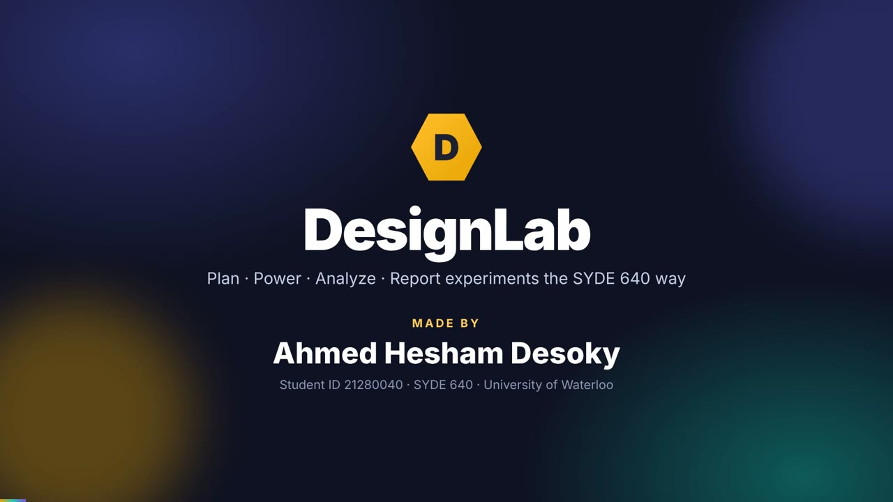

# DesignLab

A local website for SYDE 640 (Experimental Design). It walks you through the HW3 flow chart, runs the right analysis with the course's assumption checks and fallbacks, writes APA results, does G*Power-style power analysis, has a full DOE workspace (2^k, fractional factorials, RSM and robust design), and builds a report.

Ahmed Hesham Desoky, 21280040

Everything runs on your own computer. No data leaves it.

## Feature video (2 minutes)

[](media/DesignLab_features.mp4)

Click the image, then **View raw** or the download button to watch [`media/DesignLab_features.mp4`](media/DesignLab_features.mp4).

## How to run it

You only need **Python 3.10 or newer** (https://www.python.org/downloads/; on Windows tick "Add Python to PATH" during setup). The web interface is already built and included, so Node.js is **not** needed.

### 1. Get the code

Either click the green **Code → Download ZIP** button above and unzip it, or run:

```
git clone https://github.com/aiiitsh/DesignLab.git
cd DesignLab
```

### 2. Install the Python packages (once)

```
pip install -r requirements.txt
```

### 3. Start DesignLab

- **Windows:** double-click `start_designlab.bat`, or run `python run.py`
- **macOS / Linux:** run `./start_designlab.sh`, or `python3 run.py`

Your browser opens **http://127.0.0.1:8640**. If it doesn't, open that address yourself. Keep the terminal window open while you use the app; close it (or press Ctrl+C) to stop.

### 4. Optional: check the numbers

```
python -m pytest -q
```

It should show **50 passed**.

### Troubleshooting

- `pip` or `python` not found: reinstall Python with "Add Python to PATH" ticked, or use `py -m pip install -r requirements.txt` and `py run.py`.
- Port 8640 already in use: DesignLab is probably already running; open http://127.0.0.1:8640.
- Changing the interface code (`web/src`) needs Node.js 18+: `cd web && npm ci && npm run build`.

## What's inside

| Page | What it does |
|---|---|
| Home | Start a project, or open one of the worked examples (the candy choice-overload replication, Montgomery 3.1/4.1/5.1/6.2/8.1, DRP, Album Sales, Titanic and more) |
| Wizard | The HW3 flow chart as questions. It covers planning (RQ, hypotheses, variables, manipulation, controls), then picks the design and the test, explains why, and gives the fallbacks. It ends with counterbalancing, randomization, power and a data template |
| Flow chart | The full HW3 flow chart drawn inside the app (not a PDF). Drag, zoom, and search for any term to highlight every box that mentions it |
| Data | Paste straight from Excel, or import CSV/XLSX. Set column types and roles |
| Analysis | t-tests, one-way / factorial / repeated-measures / mixed ANOVA, regression (enter, hierarchical, stepwise), logistic regression and χ². Each runs its assumption checks and switches to the course fallback automatically (Mann-Whitney, Wilcoxon, Welch, Kruskal-Wallis + Dunn, Friedman, GG/HF). Results come with a decision log, effect sizes, an APA paragraph and a Python script that reproduces the numbers |
| Power | G*Power-style a priori, post hoc, sensitivity and criterion calculations with a power curve |
| DOE | 2^k and fractional designs (aliases, resolution, fold-over), Lenth and normal plots, collapsing a factor, RSM (steepest ascent, CCD/BBD, stationary point and contour) and Taguchi/robust design |
| Design tools | Latin squares (Williams), counterbalancing and randomization |
| Report | Pinned results become a report with your name and ID in the header. Export to PDF (via the browser's Print to PDF) or HTML |

Every input, label, heading and table column has a small (?) help dot. Hover it for a plain-language explanation. You can turn the dots off in the sidebar or in Settings.

Projects save as `.dlab` files (a zip holding your data and answers) so you can reopen them later.

## For developers

- `engine/` holds all the statistics in pure Python. `api/main.py` is a FastAPI app that serves it plus the built site in `web/dist`.
- `web/` is React + TypeScript + Vite. To change the interface: `cd web && npm ci && npm run dev` (it proxies `/api` to port 8640), then `npm run build`.
- `tests/` is the validation suite from spec §12. It covers the candy case DV by DV, the 20 reference cases against JASP/G*Power/Montgomery numbers, pingouin parity for RM and mixed ANOVA, the API, and a check that the exported Python scripts reproduce the numbers.
- `docs/DECISIONS.md` lists where the app departs from the spec, and why.
